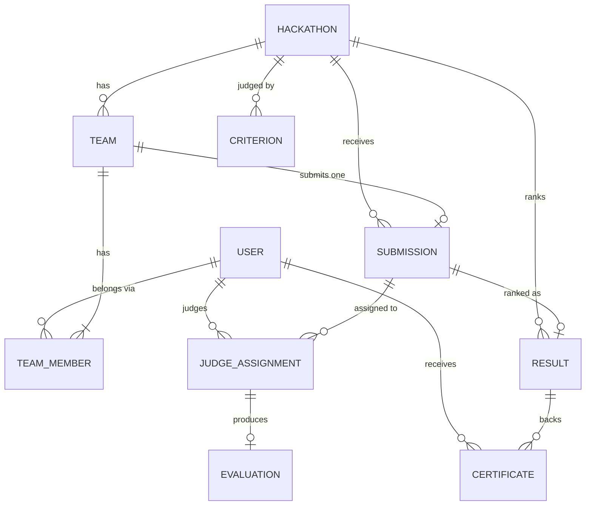

# Data model

The platform stores everything in **ten tables** in one SQLite file (`/data/dogfood.db` inside the Docker volume `dogfood-data`). The models live in `backend/app/models.py`. This document matches the schema SQLite actually creates on first start.

See also: [ARCHITECTURE.md](ARCHITECTURE.md) · [JUDGING.md](JUDGING.md)

## 1. Entity relationships



The same thing as a tree:

```
Hackathon
 ├─ Criterion*                      the rubric (e.g. 5 criteria, 100 points)
 ├─ Team*
 │   ├─ TeamMember* ──► User        1–4 participants, one is lead
 │   └─ Submission (0..1)
 │       ├─ JudgeAssignment* ──► User (judge)
 │       │   └─ Evaluation (0..1)   scores + rubric snapshot
 │       └─ Result (0..1)           rank + final score
 └─ Certificate* ──► User, Team, Result
```

## 2. Tables

Conventions:

- `id` is an integer primary key on every table.
- Timestamps are **UTC, stored without timezone** (SQLite has none) and returned by the API as ISO 8601 with a trailing `Z`.
- Every foreign key is enforced (`PRAGMA foreign_keys=ON`).

### `users` (User)

One row per account, whatever the role.

| Field | Type | Null | Notes |
|---|---|---|---|
| `email` | varchar(255) | no | **Unique** index. Matched case-insensitively at login. |
| `full_name` | varchar(120) | no | |
| `password_hash` | varchar(255) | no | bcrypt. **Never** returned by the API or exported. |
| `role` | varchar(20) | no | `admin`, `judge` or `participant`. Indexed. Self-registration always creates `participant`. |
| `created_at` | datetime | no | |

### `hackathons` (Hackathon)

The event. The app uses the most recently created row as the current event.

| Field | Type | Null | Notes |
|---|---|---|---|
| `name`, `tagline`, `description` | varchar / text | no | Shown on the sign-in page and the dashboards |
| `starts_at`, `ends_at` | datetime | no | |
| `submission_deadline` | datetime | no | Used by the eligibility rule "submitted before the deadline" |
| `min_team_size`, `max_team_size` | int | no | Seeded as 1 and 4 |
| `results_published` | bool | no | The publish switch. It gates the public leaderboard, participant results and certificates. |
| `results_published_at` | datetime | yes | |
| `results_calculated_at` | datetime | yes | Last time `Result` rows were rebuilt |
| `created_at` | datetime | no | |

**Derived, not stored:** `phase`, one of `upcoming`, `submissions_open`, `judging` or `results_published`. It's computed from the dates and the publish flag in `serializers.hackathon_phase()`.

### `teams` (Team)

| Field | Type | Null | Notes |
|---|---|---|---|
| `hackathon_id` | FK → hackathons | no | |
| `name` | varchar(80) | no | **Unique per hackathon** (`uq_team_name`). Also checked case-insensitively in code. |
| `invite_code` | varchar(16) | no | **Unique.** 6 random hex characters, e.g. `7F3A0C` |
| `created_by_id` | FK → users | no | |
| `created_at` | datetime | no | |

### `team_members` (TeamMember)

The join table between users and teams.

| Field | Type | Null | Notes |
|---|---|---|---|
| `team_id` | FK → teams | no | |
| `user_id` | FK → users | no | |
| `hackathon_id` | FK → hackathons | no | Copied from the team so the next constraint can exist |
| `is_lead` | bool | no | The creator is the lead |
| `joined_at` | datetime | no | |

**Constraint:** `uq_one_team_per_hackathon (hackathon_id, user_id)`. The database itself guarantees a person is on at most one team per event.

### `submissions` (Submission)

At most one per team.

| Field | Type | Null | Notes |
|---|---|---|---|
| `hackathon_id` | FK → hackathons | no | |
| `team_id` | FK → teams | no | **Unique**, so one submission per team |
| `submitted_by_id` | FK → users | no | The last member to save it |
| `title` | varchar(120) | no | |
| `summary` | text | no | The eligibility check needs ≥ 50 characters |
| `repo_url` | varchar(500) | no | Must be an http(s) URL to be eligible |
| `demo_url` | varchar(500) | no | Optional (empty string when unset). If set, must be an http(s) URL. |
| `tech_stack` | varchar(255) | no | Optional free text |
| `eligibility_status` | varchar(20) | no | `eligible` or `ineligible` |
| `eligibility_checks` | JSON | no | The list of checks, shown in section 3 |
| `submitted_at`, `updated_at` | datetime | no | `submitted_at` is refreshed on every save, so a late edit is judged against the deadline |

**Derived, not stored:**

- `stage` is one of `ineligible`, `awaiting_judges`, `in_review` or `evaluated`.
- `locked` is true when the submission has at least one judge assignment. Participants can't edit it after that.

### `criteria` (Criterion)

The judging rubric.

| Field | Type | Null | Notes |
|---|---|---|---|
| `hackathon_id` | FK → hackathons | no | |
| `name` | varchar(80) | no | |
| `description` | varchar(255) | no | Shown to judges and participants |
| `max_score` | int | no | 1–100 (validated by the API) |
| `position` | int | no | Display order |

### `judge_assignments` (JudgeAssignment)

"This judge must score this submission."

| Field | Type | Null | Notes |
|---|---|---|---|
| `submission_id` | FK → submissions | no | |
| `judge_id` | FK → users | no | Must have the `judge` role |
| `assigned_by_id` | FK → users | no | The admin |
| `status` | varchar(20) | no | `pending` or `completed` |
| `assigned_at` | datetime | no | |
| `completed_at` | datetime | yes | Set when the evaluation is submitted |

**Constraint:** `uq_judge_once_per_submission (submission_id, judge_id)`.

### `evaluations` (Evaluation)

One judge's scores for one assignment. They're final once submitted.

| Field | Type | Null | Notes |
|---|---|---|---|
| `assignment_id` | FK → judge_assignments | no | **Unique**, so exactly one evaluation per assignment |
| `submission_id` | FK → submissions | no | Denormalized for querying |
| `judge_id` | FK → users | no | |
| `scores` | JSON | no | **Rubric snapshot**, shown in section 3 |
| `raw_total` | float | no | Sum of the scores |
| `max_total` | float | no | Sum of `max_score` at scoring time |
| `normalized_score` | float | no | `raw_total / max_total × 100`, rounded to 2 decimals |
| `feedback` | text | no | Optional, ≤ 1000 characters. Shown to the team anonymously. |
| `submitted_at` | datetime | no | |

### `results` (Result)

Rebuilt from scratch every time results are calculated or published. One row per submission.

| Field | Type | Null | Notes |
|---|---|---|---|
| `hackathon_id` | FK → hackathons | no | |
| `submission_id` | FK → submissions | no | **Unique per hackathon** (`uq_result`) |
| `team_id` | FK → teams | no | |
| `status` | varchar(20) | no | `ranked` or `not_ranked` |
| `rank` | int | yes | Competition ranking (1, 1, 3). Null when not ranked. |
| `final_score` | float | yes | Mean of the normalized scores, 2 decimals |
| `judge_count` | int | no | Completed evaluations used |
| `pending_count` | int | no | Assignments still pending at calculation time |
| `breakdown` | JSON | no | Per-judge working, shown in section 3 |
| `note` | varchar(255) | no | For example "Not eligible", "No completed evaluations yet" or "1 evaluation(s) still pending" |
| `computed_at` | datetime | no | |

### `certificates` (Certificate)

Issued to every member of every team with a submission, at the moment of publishing. Deleted on unpublish.

| Field | Type | Null | Notes |
|---|---|---|---|
| `hackathon_id` | FK → hackathons | no | |
| `user_id` | FK → users | no | **Unique per hackathon** (`uq_certificate`) |
| `team_id` | FK → teams | no | |
| `result_id` | FK → results | yes | |
| `kind` | varchar(30) | no | `winner`, `runner_up`, `second_runner_up` or `participation` |
| `title` | varchar(80) | no | "Winner", "First Runner-up", "Second Runner-up" or "Participant" |
| `rank`, `final_score` | int / float | yes | Copied from the result |
| `verification_code` | varchar(32) | no | **Unique.** 12 random hex characters. Checked publicly at `/verify/<code>`. |
| `issued_at` | datetime | no | |

## 3. JSON column shapes

`submissions.eligibility_checks`:

```json
[
  {"rule": "Submitted before the deadline", "passed": true,  "detail": "Submitted on time."},
  {"rule": "Team size",                     "passed": true,  "detail": "2 member(s). Allowed: 1–4."},
  {"rule": "Project summary",               "passed": false, "detail": "19 characters. Needs at least 50."},
  {"rule": "Source code link",              "passed": true,  "detail": "Link looks valid."}
]
```

`evaluations.scores`, the rubric snapshot at the moment of scoring:

```json
[
  {"criterion_id": 1, "name": "Innovation",               "max_score": 20, "score": 17},
  {"criterion_id": 2, "name": "Technical Implementation", "max_score": 25, "score": 21}
]
```

`results.breakdown`, the per-judge working behind the final score:

```json
[
  {"judge": "Dr. Vikram Iyer", "raw_total": 84.0, "max_total": 100.0, "normalized_score": 84.0}
]
```

Participants and the public leaderboard see judges as "Judge 1", "Judge 2". Only admins see names.

## 4. Invariants, and where they're enforced

| Rule | Database | Application |
|---|---|---|
| Email is unique | unique index | case-insensitive check at registration |
| One team per person per event | `uq_one_team_per_hackathon` | friendly 409 before insert |
| Team names unique per event | `uq_team_name` | case-insensitive check |
| One submission per team | `submissions.team_id` unique | upsert in `PUT /api/submissions/me` |
| Same judge not assigned twice | `uq_judge_once_per_submission` | 409 |
| One evaluation per assignment | `evaluations.assignment_id` unique | 409 "already submitted" |
| Only eligible submissions get judges | — | 409 in `POST /api/admin/assignments` |
| Submission frozen once judged | — | `locked` → 409 on edit or join |
| Scores within 0..max, all criteria scored | — | 422 in the evaluation endpoint |
| No changes after publishing | — | 409 on scoring, assignment, criteria, team and submission writes |

## 5. Lifecycle of the key records

```
Submission:  (saved) ──eligibility──► eligible ──assign judge──► in_review ──all scored──► evaluated
                          └─────────► ineligible  (edit and resave to re-check)

JudgeAssignment:  pending ──evaluation submitted──► completed
                  pending ──admin removes──► (deleted)

Hackathon.results_published:  false ──publish──► true ──unpublish──► false
Result rows:        rebuilt on every calculate/publish
Certificate rows:   created on publish, deleted on unpublish or recalculation
```

## 6. Seed data

`backend/app/seed.py` runs on first start, and only when the `users` table is empty. **All names are fictional.** Dates are relative to the moment of seeding (the event started 48 hours earlier and closes in 24 hours), so the deadline is in the future whenever you first run it.

| Table | Rows | Contents |
|---|---|---|
| users | 7 | 1 admin, 1 judge, 5 participants (credentials below) |
| hackathons | 1 | "Dogfood 72-Hour Hackathon", teams of 1–4 |
| criteria | 5 | Innovation 20, Technical Implementation 25, User Experience 20, Impact 20, Presentation 15 (= 100) |
| teams | 2 | *Byte Bandits* (Priya lead, Arjun, invite `BYTE42`); *Null Pointers* (Meera lead, Kabir, invite `NULL07`) |
| team_members | 4 | The demo participant, Alex, is on **no** team, so the full flow can be demonstrated |
| submissions | 2 | *QueueLess Clinic* (Byte Bandits), *FieldNote* (Null Pointers), both eligible |
| judge_assignments | 2 | Judge on both: one completed, one **pending** |
| evaluations | 1 | QueueLess Clinic: 17 + 21 + 16 + 18 + 12 = 84 / 100 → 84.00 |
| results | 2 | Draft (unpublished): QueueLess rank 1 at 84.00; FieldNote not ranked (awaiting its evaluation) |
| certificates | 0 | Issued when the admin publishes |

| Role | Email | Password |
|---|---|---|
| Admin | `admin@dogfood.dev` | `Admin@123` |
| Judge | `judge@dogfood.dev` | `Judge@123` |
| Participant (no team yet) | `participant@dogfood.dev` | `Participant@123` |
| Seeded team members | `priya@`, `arjun@`, `meera@`, `kabir@dogfood.dev` | `Demo@2026` |

## 7. Import and export paths

### In

| Path | Command | What it does |
|---|---|---|
| Automatic seed | `docker compose up` on an empty volume | Creates tables and inserts the demo event |
| Reseed | `docker compose exec app python -m app.seed --reset` | **Drops all tables**, recreates them and seeds again |
| Seed only if empty | `docker compose exec app python -m app.seed` | No-op when data already exists |
| Restore a backup | See the commands below | Replaces the database with a saved copy |
| Self-service | UI / `POST /api/auth/register`, teams, submissions | Normal use |

**Restoring a backup.** The container runs as uid 10001, but `docker compose cp` writes files as root. The `chown` step is needed; without it the app can read the restored database but every write fails.

```bash
docker compose stop app
docker compose cp ./backup.db app:/data/dogfood.db
docker compose run --rm --no-deps -u root app chown 10001:10001 /data/dogfood.db
docker compose start app
```

Bulk import of real participants (for example from a CSV) is **not** implemented. At this scale, participants self-register.

### Out

| Path | How | Format |
|---|---|---|
| Results export | Admin → Results → **Download results (CSV)**, or `GET /api/admin/export/results.csv` | One row per submission: `rank, team, project, status, final_score, judge_count, pending_evaluations, normalized_scores, note, published`. Cells starting with `= + - @` are prefixed with `'` so spreadsheets don't run them as formulas. |
| Full event export | Admin → Results → **Download full export (JSON)**, or `GET /api/admin/export/event.json` | `format_version: 1`, then `hackathon`, `users` (no password hashes), `teams`, `submissions`, `assignments` (with evaluations), `results`, `certificates` |
| Database backup | `docker compose cp app:/data/dogfood.db ./backup.db` | The raw SQLite file. Open it with any SQLite tool. |
| Everything via API | `/api/docs` | JSON for every entity |

Both export endpoints are admin-only. They return 401 without a token and 403 for other roles.

Example with `curl`:

```bash
TOKEN=$(curl -s -X POST localhost:8000/api/auth/login -H 'content-type: application/json' \
  -d '{"email":"admin@dogfood.dev","password":"Admin@123"}' | python3 -c 'import sys,json;print(json.load(sys.stdin)["access_token"])')
curl -s -H "Authorization: Bearer $TOKEN" localhost:8000/api/admin/export/results.csv -o results.csv
curl -s -H "Authorization: Bearer $TOKEN" localhost:8000/api/admin/export/event.json -o event.json
```

## 8. Schema changes

There's no migration tool. Tables are created with `create_all()` on startup, which adds missing tables but never alters existing ones. After changing `models.py`, reset the volume with `docker compose down -v`. For a long-lived deployment, add Alembic.
